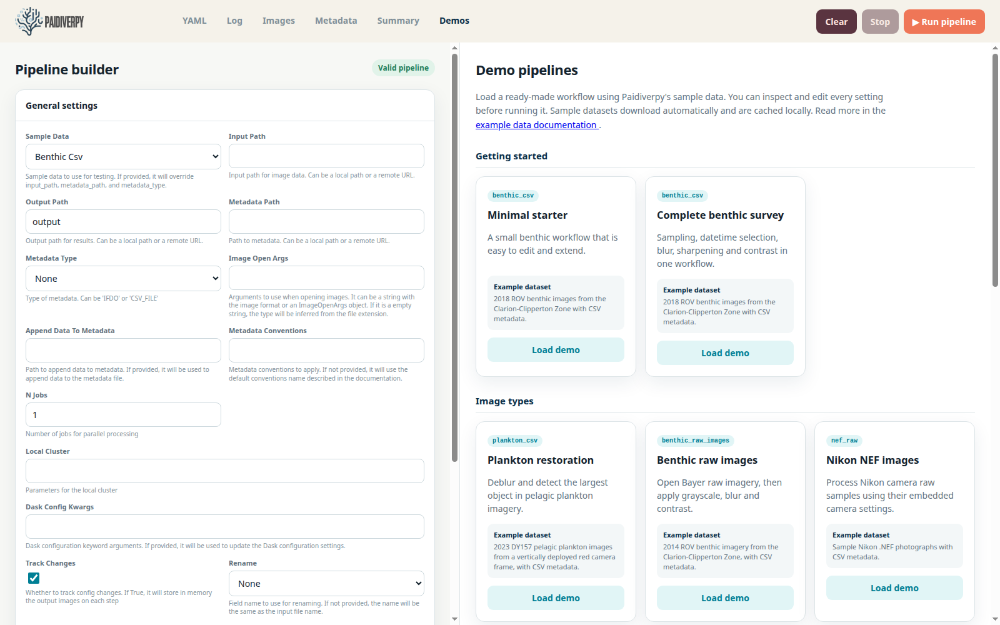
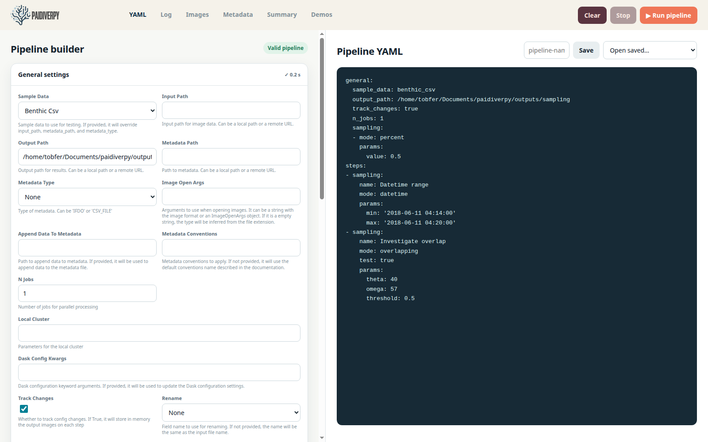
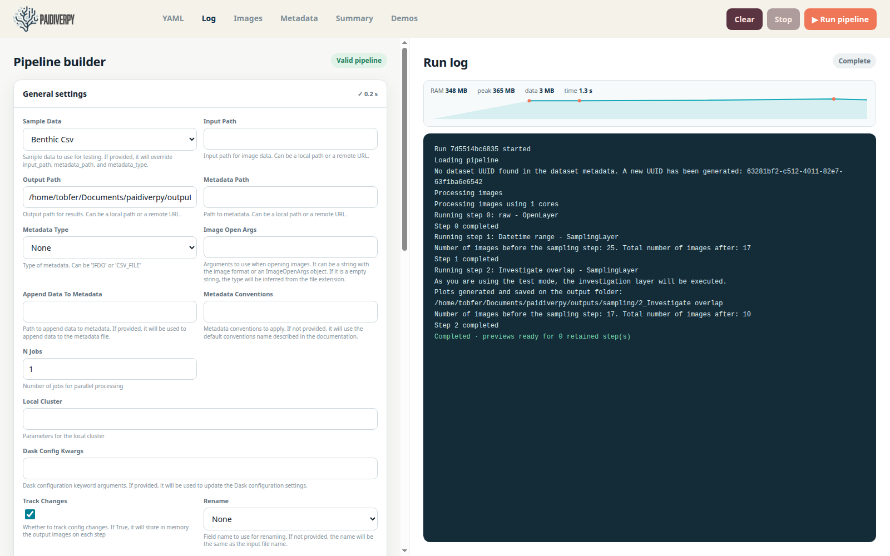
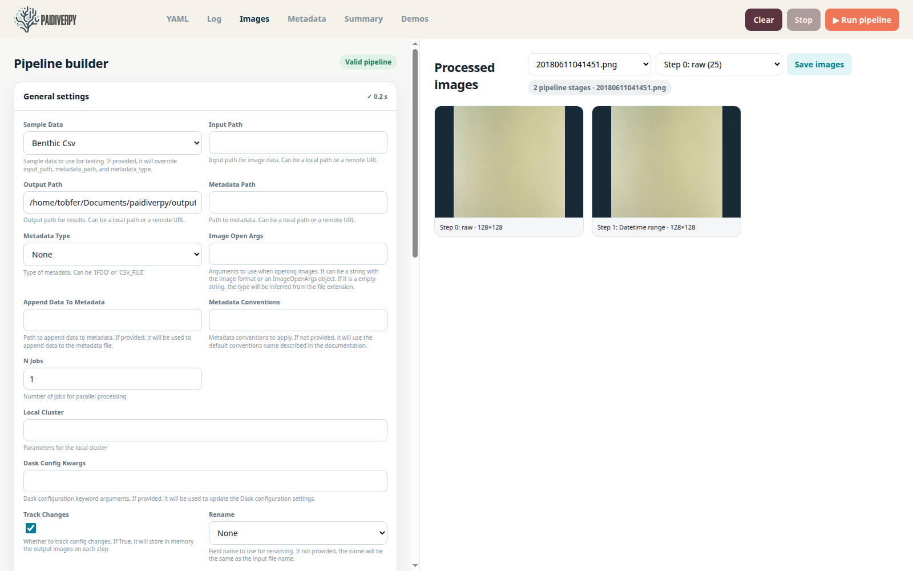
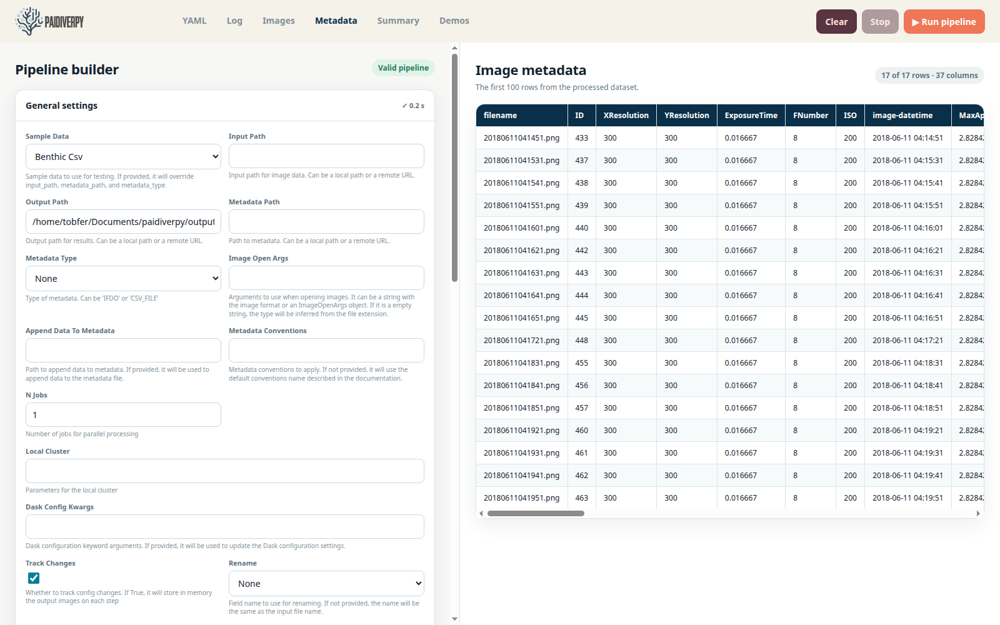
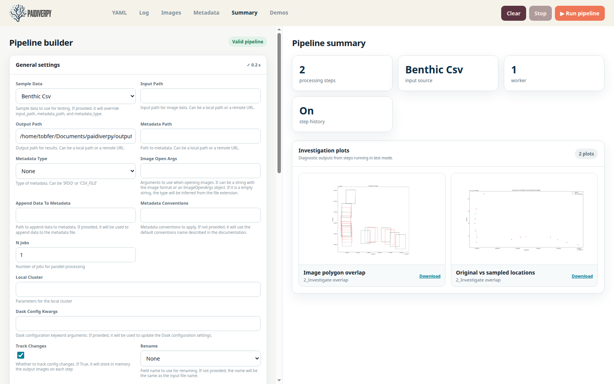

.. _gui:

Graphical User Interface (GUI)
==============================

Paidiverpy provides a browser-based dashboard for creating and running image
processing workflows without writing code. You can choose your images, add
processing steps, follow the progress of a run and inspect the results in one
place.

Opening the dashboard
---------------------

Install the optional GUI dependencies and launch the dashboard:

.. code-block:: bash

    pip install "paidiverpy[gui]"
    paidiverpy --gui

Open ``http://127.0.0.1:8792`` in a browser after starting the dashboard.
Advanced users can change the address or port if required:

.. code-block:: bash

    paidiverpy --gui --host 0.0.0.0 --port 8792

Use ``paidiverpy --help`` for the complete command-line reference. Saved
configurations and run outputs are stored under ``~/Documents/paidiverpy/``.

Interface layout
----------------

The **Pipeline builder** on the left contains the main settings and processing
steps. The area on the right contains the **YAML**, **Log**, **Images**,
**Metadata**, **Summary** and **Demos** tabs. **Run pipeline** and **Stop** are
always available at the top of the page.

The status beside **Pipeline builder** tells you whether the workflow is ready
to run. During processing, each step shows whether it is waiting, running,
complete or unsuccessful.

Creating a pipeline from a demo
-------------------------------

The **Demos** tab is the quickest way to start. Workflows are grouped by use
case and each card describes the images it uses. Select **Load demo**, review
the settings and change any values you want before running it. Example images
are downloaded automatically and reused on later runs.

The included demos cover:

- minimal and complete benthic workflows;
- plankton restoration and object detection;
- different types of image information;
- loading-time and processing-step sampling;
- raw Bayer and Nikon NEF images;
- faster processing with multiple workers; and
- a packaged custom-algorithm example.

To use your own images, set **Sample Data** to ``None`` and enter the image
location and, when available, the metadata location. **Initial sampling** can
reduce the number of images before processing starts. **Initial conversion**
can resize or convert them as they are loaded. Enable **Track Changes** when you
want to compare the result of each step. Use the controls at the bottom of the
builder to add, reorder or remove steps.

Viewing and saving the configuration
------------------------------------

The **YAML** tab is an advanced text view of the current workflow. It updates
automatically when you use the builder, so you do not need to edit it. Users
who are comfortable with YAML can edit the text directly. Selecting a setting
in either view takes you to the matching setting in the other view.

Enter a name and select **Save** to store the configuration locally. Previously
saved configurations can be restored with **Open saved**.

Running a pipeline and reading the log
--------------------------------------

Select **Run pipeline** to check and run the current workflow. The
dashboard opens the **Log** tab when processing starts, but another tab can be
selected at any time without being forced back to the log.

The resource panel shows current and highest memory use, the memory occupied by
the image data and the elapsed time. Dots on the chart mark completed steps.
The messages below explain what the dashboard is doing, and the badge in the
upper-right shows the overall run state.

Use **Stop** to request termination of an active run. **Clear** removes the
displayed results from the current browser session. It does not delete exported
files or saved configurations.

Inspecting processed images
---------------------------

The **Images** tab shows previews of the processed images. Use the step selector
to view the results from a particular stage. Alternatively, choose an image by
name to compare it across every available stage, as illustrated below.

When **Track Changes** is disabled, only the final result is available. The
badge shows how many images are available and how many previews are displayed.
Select **Save images** to save the full-size results from the chosen step. The
smaller browser previews are only used to make viewing faster.

Inspecting image metadata
-------------------------

The **Metadata** tab displays information associated with the processed images
in a table. The badge shows how many rows and columns are available. Up to the
first 100 rows are shown, and you can scroll sideways to see additional
columns.

Pipeline summary and investigation plots
----------------------------------------

The **Summary** tab provides a quick overview of the number of steps, image
source, workers and whether step history is enabled. Some investigation steps
also create charts. Expand **Investigation plots** to view them, select a chart
to open it at full size, or use **Download** to save it.

The screenshot was produced with the **Sampling strategies** demo. It creates
charts that compare image coverage and show which image locations were kept.
If a workflow does not create any charts, this section remains empty.

Working with custom algorithms
------------------------------

The **Custom algorithm** option is intended for advanced users who want to add
their own processing method. The required file must be created before starting
the run. The custom demo provides a working example that can be used as a
starting point.
